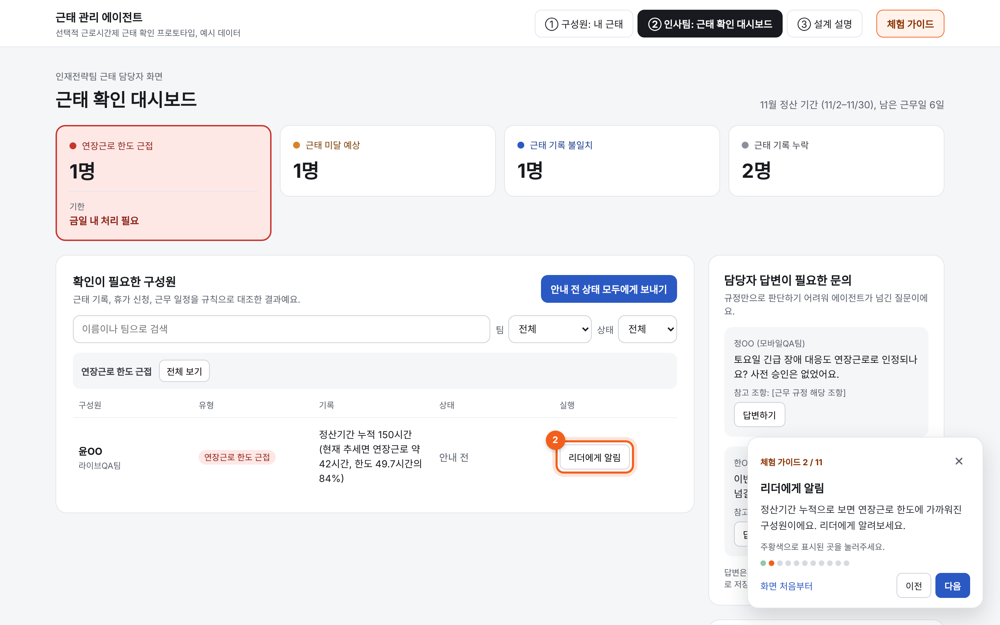
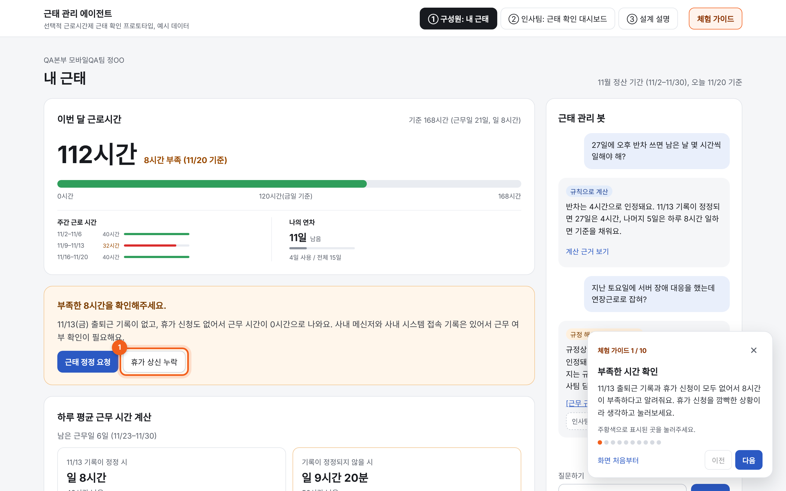

# 근태 관리 에이전트

선택적 근로시간제에서 근태 기록, 휴가 신청, 휴가 취소 기록을 대조해 인사팀이 확인해야 할 구성원만 골라내고, 구성원에게는 부족한 시간과 처리 방법을 바로 보여주는 에이전트 프로토타입입니다.

**[가상구현](https://ahyun39.github.io/time-attendance/)** 오른쪽 아래 체험 가이드가 눌러야 할 곳을 번호와 주황색 테두리로 표시합니다.



## 해결하려는 문제

| As-Is | To-Be |
|---|---|
| 담당자가 근태 기록, 휴가 결재, 출퇴근 기록을 따로 열어 대조 | 에이전트가 매일 대조해서 확인이 필요한 사람만 4가지 유형으로 올림 |
| 누락과 미달은 정산 마감 직전에 발견 | 구성원이 내 근태 화면에서 부족한 시간과 처리 방법을 바로 확인 |
| 남은 시간 계산과 규정 질문을 메신저로 반복 문의 | 규정에 답이 있는 문의는 에이전트가 처리하고, 담당자는 결정과 판단이 필요한 건만 처리 |

## 구성

| 구성 | 내용 | 구현 범위 |
|---|---|---|
| ① 구성원: 내 근태 | 이번 달 근로시간, 주간 근로 시간, 연차, 부족한 시간 처리(근태 정정 요청, 휴가 상신), 근태 관리 봇 | 버튼과 계산은 동작, 봇 답변은 미리 정한 예시 응답 |
| ② 인사팀: 근태 확인 대시보드 | 유형 카드 필터, 검색과 필터, 개별 안내와 일괄 안내, 담당자 답변이 필요한 문의, 자동 안내 예약 | 화면 상태로 동작, 실제 발송과 저장은 없음 |
| ③ 설계 설명 | 역할 분담, 문의 처리 기준, 판단 규칙, 권한과 개인정보, 한계 | 설명 페이지 |
| ④ 문의 응답 평가 | 평가 질문 24개에 대한 Solar Pro 실제 응답, 정답 비교, 규칙 보정 내용, 개선 과정 | 실행 결과 기록을 보여주는 화면 |
| 판정 규칙 `rules.py` | 예시 데이터로 4가지 유형을 실제로 계산 | 동작, 테스트 5개 |
| 문의 응답 `agent.py` | 규정 문서를 근거로 답하거나 담당자에게 넘김 (Upstage Solar Pro) | 동작, API 키 필요 |

대시보드 표의 구성원과 사유는 `rules.py`를 예시 데이터에 돌린 결과와 같습니다.



## 역할 분담

| 담당 | 하는 일 |
|---|---|
| 규칙 | 근로시간 계산, 4가지 유형 판정, 휴가 취소 기록 대조, 마감 기한 계산 |
| LLM | 규정 문서에서 근거를 찾아 답변, 규정에 기준이 있는 예외는 해당 여부까지 안내, 안내 문구 초안 작성 |
| 사람 | 승인과 정정 결정, 재량 규정 판단, 문서 간 충돌 정리, 민감한 문의, 근거를 못 찾은 질문, 대량 안내 발송 승인 |

숫자와 판정은 규칙이 만들고, LLM은 그 결과를 설명만 합니다. 이 저장소에서 구현한 것은 규칙 부분이고, LLM 부분은 화면에서 동작 방식을 보여주는 단계입니다.

## 판정 규칙

| 유형 | 조건 | 다음 행동 |
|---|---|---|
| 연장근로 한도 근접 | 지금 추세로 정산기간을 마치면 연장근로가 한도의 80% 이상 | 리더에게 알림 |
| 근태 미달 예상 | 누락을 정정된 것으로 보정해도 금일 기준 소정근로에 못 미치고, 남은 근무일에 하루 평균 9시간 넘게 필요 | 본인 안내 |
| 근태 기록 불일치 | 승인된 휴가 시간에 근무 기록이 있음 | 휴가 취소 기록을 먼저 찾아서 있으면 자동 확인, 없으면 본인 안내 |
| 근태 기록 누락 | 휴가로 채워지지 않은 근무일에 출근 또는 퇴근 기록이 없음 | 본인 안내, 정정 요청이 있으면 리더 승인 대기 |

- 선택적 근로시간제는 특정 주에 40시간을 넘겨 일할 수 있어서, 주 단위가 아니라 정산기간 누적으로 판단합니다.
- 기록 누락 때문에 생긴 부족분은 미달로 세지 않아서, 같은 사람이 두 유형에 중복으로 올라가지 않습니다.

## 예시 데이터 결과

기간 11/2~11/30 (21근무일, 168시간), 기준일 11/20 (15근무일 경과, 120시간)

```
[overtime] 윤OO 라이브QA팀: 정산기간 누적 150시간 (현재 추세면 연장근로 약 42시간, 한도 49.7시간의 84%)
[   short] 한OO 데이터분석팀: 금일 기준 14시간 부족 (이후 일 평균 10시간 20분 필요)
[mismatch] 서OO 모바일QA팀: 연차(11/18) 승인 후 출퇴근 기록 확인 (연차 취소 기록이 없어서 본인 확인 필요)
[ missing] 정OO 모바일QA팀: 휴가 신청 없음 (11/13 출퇴근 기록 X) -> 본인이 정정 요청
[ missing] 문OO 데이터분석팀: 11/19 퇴근 기록 없음 -> 본인에게 자동 안내
자동 확인:
  이OO (PC QA팀) 11/17 연차 취소 기록 확인, 출근 기록과 일치
  최OO (라이브QA팀) 11/19 오후 반차 취소 기록 확인, 퇴근 기록과 일치
```

정OO는 기록상 112시간이라 숫자만 보면 미달이지만, 부족분이 11/13 누락 하나로 설명되므로 누락으로만 올라갑니다.

## LLM 연결: 문의 응답 (Upstage Solar Pro)

`agent.py`가 구성원 질문을 받아 규정 문서를 근거로 직접 답할지, 인사팀에 넘길지 판단합니다.

1. 규정 문서(`regs/`) 전체와 질문을 넣습니다. 문서가 작아서 검색 없이 모두 넣었고, 문서가 많아지면 조항 단위 검색으로 바꿀 부분입니다.
2. 본인 근태를 묻는 질문이면 `rules.py`가 계산한 숫자를 함께 넣습니다. LLM은 이 숫자를 설명만 하고 새로 계산하지 않습니다.
3. 결과는 처리 경로(자동 답변 또는 넘김), 넘기는 이유, 근거 조항, 답변을 담은 JSON으로 받습니다.

LLM 응답은 그대로 쓰지 않고 규칙으로 한 번 더 검사합니다.

| 규칙 | 하는 일 |
|---|---|
| 민감한 주제 차단 | 괴롭힘, 임신, 징계, 퇴직 같은 질문은 LLM에 보내지 않고 바로 담당자에게 넘깁니다. 민감한 개인 사정을 외부 API로 보내지 않기 위해서입니다 |
| 경로 보정 | 답변은 담당자에게 넘긴다고 말하는데 경로가 자동 답변이면 넘김으로 바꿉니다 |
| 등록된 문서 간 충돌 | 인사팀이 `regs/conflicts.json`에 등록한 충돌 주제를 묻고 그 조항을 근거로 쓰면 담당자에게 넘깁니다 |
| 이유 이름 맞춤 | 넘기는 이유를 정해진 6가지 이름으로 맞춥니다 |

### 평가

`eval/questions.csv`의 질문 24개(자동 답변 12개, 넘김 12개)로 처리 경로, 넘기는 이유, 근거 조항, 숫자를 채점했습니다. 모델은 `solar-pro4-260806`입니다.

| 회차 | 처리 경로 | 넘기는 이유 | 규칙 보정 | 바꾼 내용 |
|---|---|---|---|---|
| 1차 | 23/24 | 8/12 | 0개 | 첫 실행 |
| 2차 | 22/24 | 10/12 | 2개 | 이유 이름과 우선순위 지정, 경로 보정 추가, 날짜를 숫자 검사에서 제외 |
| 3차 | 22/24 | 10/12 | 3개 | 보정 문구 범위 축소, 문서 간 충돌 목록 추가, 승인과 재량 정의 구분 |
| 4차 | 24/24 | 12/12 | 4개 | 충돌 목록은 질문 주제가 맞을 때만 적용, 민감한 주제 사전 차단 |

4차 기준 근거 조항 20/20, 필요한 숫자 2/2, 근거 없는 숫자 0개입니다. LLM에 보낸 22개 중 20개는 LLM이 맞혔고, 틀린 2개(규정과 공지가 충돌하는 이월 질문)는 규칙이 잡았습니다. 질문별 응답은 화면의 ④ 문의 응답 평가와 `eval/report.md`에 있습니다.

- 평가 질문에 맞춰 수정을 반복했기 때문에 처음 보는 질문에서 같은 결과를 보장하지 않습니다. 민감한 주제 목록과 충돌 목록도 평가 질문의 사례를 담고 있습니다.
- temperature 0으로 실행해도 같은 질문에 회차마다 응답이 달라지는 경우가 있었습니다.
- 다음 단계는 평가에 쓰지 않은 질문으로 따로 확인하고, 같은 설정을 여러 번 실행해 평균을 보는 것입니다.

## 실행 방법

화면

```bash
python3 -m http.server 8080 -d docs   # http://localhost:8080 접속
```

`index.html`을 파일로 바로 열면 화면을 불러오지 못합니다. 8080 포트가 사용 중이면 다른 숫자로 바꿔 실행하세요.

판정 규칙 (Python 3.9 이상, 표준 라이브러리만 사용, 테스트에만 pytest)

```bash
python3 make_sample_data.py   # data/에 예시 CSV 생성
python3 rules.py              # 판정 결과 출력
python3 -m pytest -q          # 테스트 5개
```

문의 응답 (Upstage API 키 필요)

```bash
cp .env.example .env          # .env에 UPSTAGE_API_KEY 입력
python3 agent.py "오후 반차 쓰면 몇 시간으로 인정돼?"
python3 agent.py "11/13 기록이 정정되면 남은 기간에 하루 몇 시간씩 일해야 해?" --asker E04
python3 run_eval.py           # 평가 세트 24개 실행, eval/report.md 생성
```

## 입력 데이터 (data/)

| 파일 | 내용 |
|---|---|
| employees.csv | 사번, 이름, 팀 |
| attendance.csv | 날짜별 출근, 퇴근 시각 (퇴근이 비어 있으면 기록 누락) |
| leaves.csv | 승인된 휴가 (연차, 공가, 오전 반차, 오후 반차) |
| leave_cancellations.csv | 휴가 취소 기록 |
| correction_requests.csv | 구성원이 올린 근태 정정 요청 |
| notifications.csv | 이미 보낸 자동 안내 |

## 한계와 전제

- 데이터는 모두 가상의 예시이고, 규정 값은 가정입니다. 연장근로 한도(주 평균 12시간 × 정산기간 주 수), 알림 기준(한도의 80%), 미달 기준(하루 9시간)은 `rules.py`의 `CONFIG`에서 실제 규정으로 바꿔야 합니다.
- 근태 시스템과 결재 시스템의 데이터 연동을 전제로 합니다.
- 탄력적 근로시간제와 재량 근로시간제는 규칙을 따로 정의해야 합니다.
- 법적 해석은 인사팀과 노무 검토를 거쳐야 하며, 이 코드는 법률 판단을 대신하지 않습니다.

## 폴더 구조

```
├── rules.py               판정 규칙
├── agent.py               문의 응답 에이전트 (Solar Pro)
├── run_eval.py            문의 처리 평가
├── test_rules.py          테스트
├── make_sample_data.py    예시 데이터 생성
├── data/                  예시 CSV
├── regs/                  가상 규정 문서, 등록된 문서 간 충돌 (conflicts.json)
├── eval/                  문의 처리 평가 세트, 평가 결과 (report.md)
└── docs/                  GitHub Pages
    ├── index.html         화면 전환과 체험 가이드
    ├── tour.js            체험 가이드 단계
    ├── dc-lite.js         화면 원본을 브라우저에서 실행하는 런타임
    ├── screens/           화면 원본 (.dc.html)
    └── images/            README 스크린샷
```
